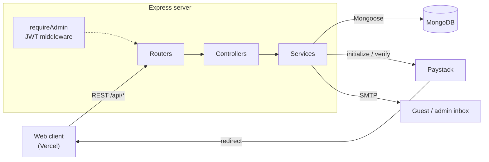
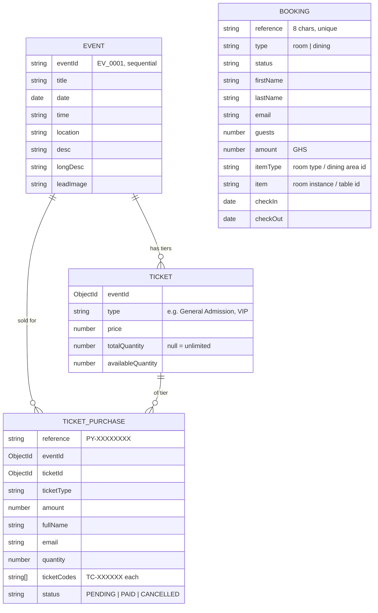
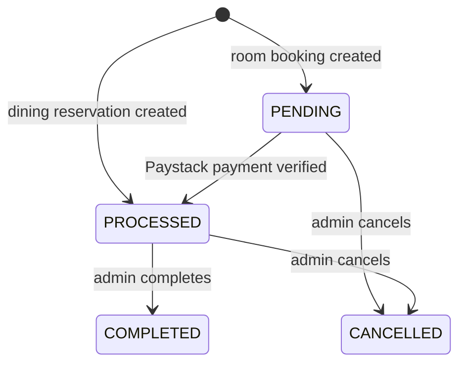

<div align="center">

# Amethyst Suites & Dining: API

### The REST backend for Amethyst. It handles room and dining bookings, events, ticket sales, Paystack payments and email.

**Live site: [amethyst-sd.vercel.app](https://amethyst-sd.vercel.app)** · **Web client: [amethyst-frontend](https://github.com/FosterSOAsare/amethyst-frontend)**


-0ba4db.svg)


</div>

---

## Table of contents

- [Overview](#overview)
- [Tech stack](#tech-stack)
- [Architecture](#architecture)
- [Project structure](#project-structure)
- [Getting started](#getting-started)
- [Environment configuration](#environment-configuration)
- [Data model](#data-model)
- [Booking lifecycle](#booking-lifecycle)
- [Ticket purchase lifecycle](#ticket-purchase-lifecycle)
- [API reference](#api-reference)
- [Email templates](#email-templates)
- [Deployment](#deployment)
- [Known limitations](#known-limitations)
- [Author](#author)
- [License](#license)

---

## Overview

This service is the backend for the [Amethyst web client](https://github.com/FosterSOAsare/amethyst-frontend). It stores the data that changes, and nothing else:

- **Bookings.** Room stays and dining reservations, with checks for overlapping dates.
- **Events and ticket tiers.** Admins can create, edit and delete them.
- **Ticket purchases.** A unique code is issued for each ticket once payment is confirmed.

Guests don't need accounts. They find their bookings with a **reference and email address**. Admin routes are protected by **one shared passcode**, which is exchanged for a JWT. Payments go through **Paystack** in Ghana cedis, and the server checks each payment with Paystack before it changes any status.

The room catalogue, dining areas, menu and other marketing content live as static data in the web client. The only exception is the nightly room rates, which the server also keeps so it can work out the price itself (see [Known limitations](#known-limitations)).

---

## Tech stack

| Concern | Technology | Notes |
| --- | --- | --- |
| Runtime | Node.js 20+ · TypeScript (strict) | Compiled to CommonJS in `dist/` |
| HTTP | Express 5 · `cors` | All feature routes are mounted under `/api` |
| Database | MongoDB · Mongoose 8 | Four models: `Booking`, `Event`, `Ticket`, `TicketPurchase` |
| Validation | Zod 4 | Schemas for event, ticket purchase and contact input |
| Auth | `jsonwebtoken` | The admin passcode is exchanged for a 30‑day token |
| Payments | Paystack (via `axios`) | Initialize and verify a transaction, in GHS |
| Email | Nodemailer (SMTP) | HTML templates with `{{placeholder}}` fields |
| Dev | `tsx watch` | Reloads when files change |

---

## Architecture



Each feature folder follows the same pattern: **router → controller → service**.
- The router defines the routes and adds `requireAdmin` where it's needed.
- The controller reads the request and returns the HTTP response.
- The service holds the business rules and does the database work.

---

## Project structure

```
server/
├── src/
│   ├── index.ts                 # Express app, CORS, JSON body, route mounting, /health, DB connect
│   └── features/
│       ├── auth/                # POST /login (passcode → JWT), GET /me, requireAdmin middleware
│       ├── booking/             # model, schema, service (overlap check, pricing, Paystack), router
│       ├── events/              # model, Zod schema, service (CRUD, ticket purchase/verify), router
│       ├── tickets/             # Ticket (tier) and TicketPurchase models
│       ├── payment/             # PaystackService: createPaymentLink, validatePayment
│       ├── contact/             # Contact form → email to ADMIN_EMAIL
│       └── shared/
│           ├── config/db.ts     # Mongoose connection
│           ├── email.service.ts # transporter, template loader, send helpers
│           └── utils.ts         # generateReference(prefix, length)
├── templates/                   # booking-confirmation, ticket-purchase, contact-form (HTML)
├── schema.txt                   # original data-model notes
├── .env.example
└── tsconfig.json
```

---

## Getting started

### Prerequisites

- **Node.js 20 or newer** and npm
- A **MongoDB** database, either local (`mongodb://localhost:27017/restaurant`) or a free [MongoDB Atlas](https://www.mongodb.com/atlas) cluster
- A **Paystack** account; [test keys](https://dashboard.paystack.com/#/settings/developers) are enough for local development
- (Optional) **SMTP** credentials. Without them, the server logs each email to the console instead of sending it

### Install and run

```bash
git clone https://github.com/FosterSOAsare/amethyst-backend.git server
cd server
npm install
cp .env.example .env     # then fill in the values (see below)
npm run dev              # http://localhost:8000
```

Check it's running:

```bash
curl http://localhost:8000/health
# {"status":"ok"}
```

Then point the web client at it with `VITE_API_URL=http://localhost:8000/api`.

### Scripts

| Script | What it does |
| --- | --- |
| `npm run dev` | Runs `src/index.ts` with `tsx watch` |
| `npm run build` | Compiles TypeScript into `dist/` |
| `npm start` | Runs `node dist/index.js` |
| `npm run prod` | Builds, then starts |

---

## Environment configuration

Every variable is listed in [`.env.example`](.env.example).

| Variable | Required | Purpose |
| --- | --- | --- |
| `PORT` | No | Port to listen on (default `8000`) |
| `MONGODB_URI` | Yes | MongoDB connection string. The server won't start without it |
| `JWT_SECRET` | Yes | Secret used to sign and verify admin tokens |
| `ADMIN_PASSCODE` | Yes | Shared admin passcode (`ADMIN_CODE` also works) |
| `PAYSTACK_SECRET_KEY` | Yes, for payments | Paystack secret key. Without it, payment routes return an error |
| `FRONTEND_URL` | Yes | Web client base URL, used for Paystack callbacks and the links in emails |
| `SMTP_HOST` | No | SMTP host (default `smtp.gmail.com`) |
| `SMTP_PORT` | No | SMTP port (default `587`) |
| `SMTP_SECURE` | No | `true` for TLS; automatically on when the port is `465` |
| `SMTP_USER` / `SMTP_PASS` | No | SMTP login. If left blank, emails are logged to the console instead |
| `ADMIN_EMAIL` | No | Inbox that receives contact form messages |

> `.env` is gitignored. Never commit real credentials.

---

## Data model



Every model also has `createdAt` and `updatedAt`.

---

## Booking lifecycle



When a booking is created (`POST /api/bookings`), the service:

1. Rejects check‑in dates in the past, a check‑out that isn't after the check‑in, guest counts below 1 and invalid emails.
2. Rejects the booking if the same `item` already has a booking that isn't cancelled and overlaps it (`checkIn < existing.checkOut && checkOut > existing.checkIn`).
3. For rooms, works out the amount on the server as `nightly rate × nights`, using the room type's rate.
4. Creates an 8‑character reference and saves the booking:
   - **Rooms** are saved as `PENDING`, and the response includes a Paystack checkout link.
   - **Dining** reservations are saved as `PROCESSED`, and a confirmation email goes out straight away.

When the guest comes back from Paystack, `GET /api/bookings/verify-payment/:reference` takes the booking reference from the transaction reference (the part before any `-timestamp` suffix). It verifies the payment with Paystack, sets the status to `PROCESSED` and sends the confirmation email. If the booking is already processed, calling it again changes nothing.

`POST /api/bookings/:reference/payment` creates a new transaction (`REF-<timestamp>`) for a `PENDING` booking, so a guest whose first payment failed can try again.

> `CONFIRMED` exists in the status enum but no current flow uses it.

---

## Ticket purchase lifecycle

1. `POST /api/events/tickets/purchase` checks that the tier has enough tickets left, saves a `PENDING` purchase with a `PY-` reference and returns a Paystack checkout link.
2. After payment, `GET /api/events/tickets/verify/:reference` verifies the payment with Paystack. It then marks the purchase `PAID`, creates one `TC-XXXXXX` code per ticket, lowers `availableQuantity` and emails the codes to the buyer.
3. The same route also accepts a **single ticket code**. For a paid purchase, it returns only that ticket and hides the payment reference and the other codes from the same purchase. This is what door staff use to check tickets.

---

## API reference

Base URL: `http://localhost:8000/api`. Admin routes need `Authorization: Bearer <token>`. Errors come back as `{ "message": "..." }`.

### Auth

| Method | Route | Access | Description |
| --- | --- | --- | --- |
| `POST` | `/auth/login` | Public | Body `{ "passcode": "..." }` → `{ token, ... }` |
| `GET` | `/auth/me` | Admin | Get the admin the token belongs to |

### Bookings

| Method | Route | Access | Description |
| --- | --- | --- | --- |
| `POST` | `/bookings` | Public | Create a booking. Returns `{ booking, payment }` |
| `GET` | `/bookings/check-availability?type=&itemType=&item=` | Public | Get `{ bookedPeriods: [{ start, end }] }` for upcoming bookings |
| `GET` | `/bookings/verify?reference=&email=` | Public | Find a booking by reference and email |
| `GET` | `/bookings/verify-payment/:reference` | Public | Verify a Paystack payment and mark the booking `PROCESSED` |
| `POST` | `/bookings/:reference/payment` | Public | Get a new Paystack link for a `PENDING` room booking |
| `GET` | `/bookings/:id` | Public | Get a booking by its reference |
| `GET` | `/bookings?type=&status=` | Admin | List bookings, newest first |
| `POST` | `/bookings/:id/complete` | Admin | Set the status to `COMPLETED` |
| `POST` | `/bookings/:id/cancel` | Admin | Set the status to `CANCELLED` |

Example body for creating a booking:

```json
{
  "type": "room",
  "itemType": "rm_02",
  "item": "inst_05",
  "firstName": "Ama",
  "lastName": "Mensah",
  "email": "ama@example.com",
  "guests": 2,
  "checkIn": "2026-12-12",
  "checkOut": "2026-12-15"
}
```

### Events and tickets

| Method | Route | Access | Description |
| --- | --- | --- | --- |
| `GET` | `/events` | Public | List events, each with its ticket tiers |
| `GET` | `/events/:id` | Public | Get one event |
| `POST` | `/events` | Admin | Create an event and its ticket tiers |
| `PUT` | `/events/:id` | Admin | Update an event and its tiers |
| `DELETE` | `/events/:id` | Admin | Delete an event |
| `POST` | `/events/tickets/purchase` | Public | Body `{ eventId, ticketId, fullName, email, quantity? }`. Returns a Paystack link |
| `GET` | `/events/tickets/verify/:reference` | Public | Verify a `PY-` payment, or look up a single `TC-` code |
| `GET` | `/events/tickets/ref/:reference` | Public | Get a purchase by its payment reference |
| `GET` | `/events/tickets/email/:email` | Public | List purchases for an email address |

Example body for creating an event:

```json
{
  "title": "Summer Jazz Night",
  "date": "2026-12-20",
  "time": "19:00",
  "location": "Rooftop Lounge",
  "desc": "An evening of live jazz under the city lights.",
  "leadImage": "https://images.example.com/jazz.jpg",
  "tickets": [
    { "type": "General Admission", "price": 50 },
    { "type": "VIP Table", "price": 150, "totalQuantity": 20 }
  ]
}
```

### Contact and health

| Method | Route | Access | Description |
| --- | --- | --- | --- |
| `POST` | `/contact` | Public | Body `{ name, email, subject, message }`. Emails `ADMIN_EMAIL` |
| `GET` | `/health` | Public | Returns `{ "status": "ok" }`. This route is **not** under `/api` |

---

## Email templates

Templates are plain HTML files in [`templates/`](templates/). `{{key}}` fields are filled in when the email is sent, and `{{#each ticketCodes}}…{{/each}}` repeats a block once per ticket code.

| Template | Sent when | Subject |
| --- | --- | --- |
| `booking-confirmation.html` | A dining reservation is created, or a room payment is verified | Booking Confirmation – Amethyst Suites & Dining |
| `ticket-purchase.html` | A ticket payment is verified | Your Tickets – Amethyst Suites & Dining |
| `contact-form.html` | The contact form is submitted | New Contact: *subject* |

Email failures are logged but never thrown, so a mail server outage doesn't stop a booking or purchase from completing.

---

## Deployment

The API is one long‑running Node process, so it runs on any Node host.

1. Build with `npm install && npm run build`, then start with `npm start`.
2. Set every variable from [Environment configuration](#environment-configuration). Set `FRONTEND_URL` to `https://amethyst-sd.vercel.app` so Paystack redirects and email links go back to the live site.
3. In MongoDB Atlas, add the host's outbound IP to the network allowlist.
4. Use `/health` as the platform's health check.
5. Set `VITE_API_URL` on the Vercel project to `<your-api-host>/api`.

Switch to Paystack **live** keys only once everything works end to end with test keys.

---

## Known limitations

- **Room rates are stored twice.** The nightly prices are hard‑coded in `booking/service.ts` and also in the web client's room data. Change both together.
- **Payments are only confirmed by the redirect.** If a guest closes the tab after paying but before being sent back, the booking stays `PENDING` until someone calls the verify route. A Paystack webhook would fix this.
- **Ticket stock isn't held while payment is pending.** Stock only goes down after payment, so two buyers paying at the same time could oversell a limited tier.
- **Validation errors come back as `500`.** Some rule failures in the booking service are returned as a generic server error instead of a `400`.
- **CORS accepts every origin.** In production, restrict it to the frontend's domain.
- **One shared admin passcode.** There are no separate admin accounts or roles, and tokens last 30 days.

---

## Author

Built by **Foster Solomon Owusu Asare** ([@FosterSOAsare](https://github.com/FosterSOAsare)).

---

## License

Released under the **MIT License**. Third‑party dependencies keep their own licenses.
